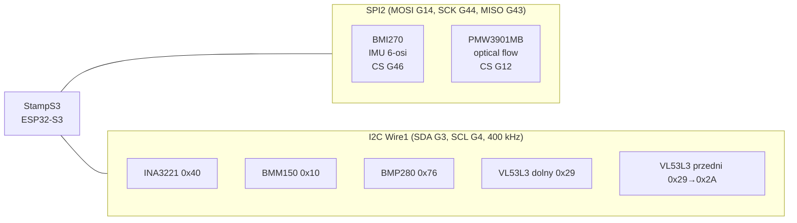

# 01. Sprzęt

## Wersje sprzętu obsługiwane przez ten projekt

| Element | Wersja | Uwagi |
|---|---|---|
| Dron | **M5Stack StampFly v1.0 (K138)** z modułem **M5StampS3** (ESP32-S3FN8, 8 MB flash) | **Nie** v1.1 (Stamp-S3A). Firmware nie był testowany na v1.1. |
| Pilot | **Atom JoyStick (K137)** z **AtomS3** (ESP32-S3FN8) | **Nie** v1.1 z AtomS3R. Używamy środowiska PlatformIO `m5stack-atoms3`. |
| Bateria | BETAFPV 300 mAh 1S LiHV (4,35 V) | Zgodna ze specyfikacją StampFly (300 mAh, 4,35 V). |

Źródła: [StampFly (docs.m5stack.com)](https://docs.m5stack.com/en/app/StampFly),
[Atom JoyStick (docs.m5stack.com)](https://docs.m5stack.com/en/app/Atom_JoyStick),
kod upstreamu [`m5stack/M5StampFly`](https://github.com/m5stack/M5StampFly) i
[`m5stack/Atom-JoyStick`](https://github.com/m5stack/Atom-JoyStick).

Kolumna „Źródło” w tabelach poniżej: **DOC** = oficjalna strona produktu M5Stack,
**UP** = kod upstreamu (działający firmware fabryczny). Gdy oba źródła się zgadzają,
podane są oba.

## StampFly — czujniki i magistrale

### SPI

| Sygnał | GPIO | Źródło |
|---|---|---|
| MOSI | G14 | DOC, UP |
| SCK | G44 | DOC, UP |
| MISO | G43 | DOC, UP |
| CS BMI270 | G46 | DOC, UP |
| CS PMW3901MB-TXQT („CS2”) | G12 | DOC; UP ustawia G12 jako wyjście w stanie wysokim, ale nie obsługuje czujnika |

Upstream inicjalizuje magistralę `SPI2_HOST` (ESP-IDF `spi_master`), BMI270 pracuje
z zegarem 8 MHz. ⚠️ Zewnętrzny projekt `kouhei1970/stampfly_hal` podaje CS = G47 dla
PMW3901 — sprzeczne z dokumentacją M5Stack. Przyjmujemy G12; sterownik sprawdza
Product ID czujnika przy starcie, więc błędny pin zostanie wykryty (optical flow
zostanie wyłączony, a tryb Position Hold będzie niedostępny).

### I2C (`Wire1`, SDA G3, SCL G4, 400 kHz)

| Układ | Adres (7 bit) | Źródło | Używany przez upstream |
|---|---|---|---|
| INA3221 (napięcie/prąd) | 0x40 | DOC, UP | tak — tylko napięcie kanału 2 |
| BMM150 (magnetometr) | 0x10 | DOC | **nie** |
| BMP280 (barometr) | 0x76 | DOC | tylko odczyt i telemetria (`baro_pa`, `baro_temp_c`), regulator z niego nie korzysta |
| VL53L3 dolny (ToF) | 0x29 | DOC, UP | tak — wysokość |
| VL53L3 przedni (ToF) | 0x29 → zmieniany na 0x2A | UP | tak — tylko w trybie parkowania |

### Pozostałe piny

| Funkcja | GPIO | Źródło |
|---|---|---|
| VL53L3 dolny: XSHUT / INT | G7 / G6 | UP |
| VL53L3 przedni: XSHUT / INT | G9 / G8 | UP |
| Silnik przód-lewy (FL) | G5 | UP |
| Silnik przód-prawy (FR) | G42 | UP |
| Silnik tył-lewy (RL) | G10 | UP |
| Silnik tył-prawy (RR) | G41 | UP |
| Buzzer (pasywny) | G40 | DOC, UP |
| WS2812 na płycie drona (2 szt.) | G39 | DOC (RGB), UP (liczba diod) |
| WS2812 na module StampS3 | G21 | UP |
| Przycisk na module StampS3 (BOOT) | G0 | UP |
| Grove (czerwony): SDA / SCL | G13 / G15 | DOC |
| Grove (czarny): I / O | G1 / G2 | DOC |

Silniki: PWM 150 kHz, rozdzielczość 8 bit (UP). Silniki 716, 17600 kV (DOC).

Bocznik INA3221: **R12 = 10 mΩ na kanale 2** (schemat płyty głównej w PDF dokumentacji
StampFly), między tranzystorem ochronnym Q1 a szyną `VBAT_IN`, więc mierzy prąd całego drona.
Biblioteka INA3221 ma domyślnie 10 mΩ, więc `getCurrent(INA3221_CH2)` zwraca ampery
(zakres ±16 A, rozdzielczość 4 mA). Firmware czyta na razie tylko napięcie `VBAT_IN`;
prąd nie jest jeszcze logowany (propozycja w [fpv_camera_integration.md](fpv_camera_integration.md#111-prąd-baterii-w-telemetrii-ibat_a)).
Schemat zasilania (Q1, bocznik, dioda do „+5VOUT”, brak bezpiecznika i wyłącznika):
[fpv_camera_integration.md](fpv_camera_integration.md#2-zasilanie-stampfly-i-punkty-podłączenia).

### Specyfikacja (DOC)

- Masa 27,7 g, wymiary 81,5 × 81,5 × 31 mm.
- VL53L3C: zasięg do 3 m.
- Bateria 300 mAh, 4,35 V; czas lotu ok. 4 min; ładowanie (5 V/1 A) ok. 55 min.

## Atom JoyStick (K137)

| Funkcja | Wartość | Źródło |
|---|---|---|
| Koprocesor | STM32F030F4P6, I2C adres **0x59** | DOC, UP |
| I2C AtomS3 ↔ STM32 | SDA G38, SCL G39 (`Wire1`, 400 kHz) | DOC, UP |
| Buzzer | G5 | DOC |
| WS2812C (2 szt.) | G6 | DOC |
| Ładowanie | TP4067, 4,35 V, 430 mA | DOC |

Firmware STM32 **nie jest modyfikowany**. Rejestry STM32 używane przez upstream
(`lib/ATOMS3Joy/atoms3joy.h`):

| Rejestr | Zawartość |
|---|---|
| 0x00 / 0x02 | lewy drążek X / Y (2 bajty, LE, 12 bit, środek ≈ 2048) |
| 0x20 / 0x22 | prawy drążek X / Y |
| 0x70 / 0x71 | wciśnięcie lewego / prawego drążka (aktywne niskim stanem) |
| 0x72 / 0x73 | lewy / prawy przycisk przedni (aktywne niskim stanem) |
| 0x60 / 0x62 | napięcie baterii CH1 / CH2 w mV |

Mapowanie przycisków (UP, `NEW_ATOM_JOY`): indeks 0 = lewy przycisk przedni,
1 = prawy przycisk przedni, 2 = wciśnięcie lewego drążka, 3 = wciśnięcie prawego drążka.

## Baterie — zasady (DOC)

- Nie rozładowywać pod obciążeniem poniżej 3,0 V na ogniwo.
- Nie przechowywać naładowanych baterii dłużej niż 3 dni; do przechowywania
  3,8–3,9 V. Firmware pilota (UP) piszczy na ekranie startowym, gdy napięcie
  baterii w slocie osiągnie ok. 3,85 V — przydatne przy rozładowywaniu do przechowania.
- Ładowanie w slotach CH1/CH2 pilota po podłączeniu kabla USB; dioda czerwona =
  ładowanie, zielona = naładowana (4,35 V). Ładowanie (5 V/1 A) ok. 55 min.

Dodatkowe zalecenia z README firmware'u autora (M5Fly-Kanazawa/StampFly2024June):
wtyk baterii wkładać ostrożnie — przesunięty wtyk może spalić elektronikę i grozi
zapłonem baterii; przy pracy w pobliżu śmigieł używać okularów ochronnych.
