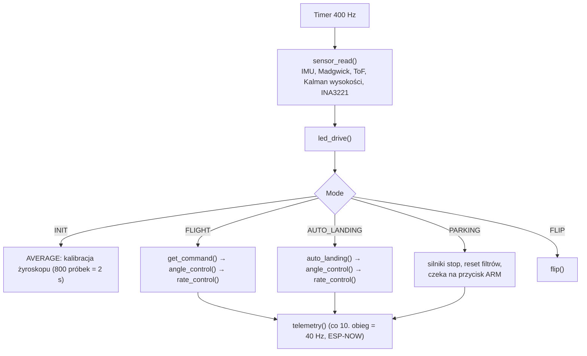
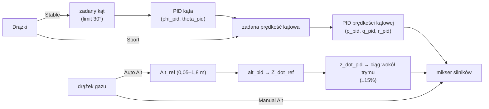
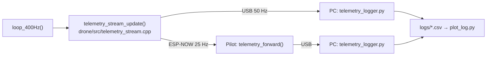

# 03. Architektura

## Struktura repozytorium

```
.
├── drone/            # firmware StampFly (git subtree z m5stack/M5StampFly)
│   ├── src/          #   kod upstreamu + nasze „haczyki” oznaczone [POSHOLD]
│   ├── lib/poshold/  #   NASZ kod niezależny od sprzętu (estymator, regulator, pomocnicze)
│   └── test/         #   testy jednostkowe `native`
├── joystick/         # firmware pilota (git subtree z m5stack/Atom-JoyStick/examples/StampFlyController)
├── tools/            # skrypty Pythona: telemetria, wykresy, analiza logów
├── docs/             # ta dokumentacja
└── .github/workflows # CI: kompilacja obu projektów + testy native
```

Zasada: nasze zmiany żyją w osobnych plikach (`lib/poshold/`, nowe pliki w `src/`),
a w plikach upstreamu są tylko krótkie wywołania oznaczone komentarzem `[POSHOLD]`.
Dzięki temu `git subtree pull` z upstreamu daje konflikty tylko w tych miejscach.

## Firmware drona (stan upstreamu)

### Pętla główna

Timer sprzętowy co 2500 µs ustawia flagę; `loop_400Hz()` czeka na nią aktywnie,
więc cała logika sterowania działa z częstotliwością **400 Hz** w jednym wątku.



### Częstotliwości

| Element | Częstotliwość | Uwagi |
|---|---|---|
| Pętla sterowania, IMU (BMI270, SPI 8 MHz), filtr Madgwicka | 400 Hz | |
| Dolny ToF (VL53L3, tryb MEDIUM, budżet 33 ms) | ~30 Hz | odczyt po przerwaniu INT |
| Filtr Kalmana wysokości | 400 Hz | predykcja z akcelerometru, korekcja ToF |
| Telemetria ESP-NOW upstreamu (`88 88`) | 40 Hz | pakiet 120 B, czyta ją UI pilota |
| Telemetria binarna `[POSHOLD]` — USB drona | 50 Hz | ramki `A5 5A`, [ADR 0003](decyzje/0003-telemetria-binarna.md) |
| Telemetria binarna `[POSHOLD]` — ESP-NOW → USB pilota | 25 Hz | ramki `A5 5A` |
| Pętla pilota | 100 Hz | timer 10 ms |

### Estymacja

- **Orientacja:** filtr Madgwicka (tylko IMU, bez magnetometru) — przechylenie i pochylenie
  są stabilne, **kąt yaw dryfuje** (całkowanie żyroskopu).
- **Układ osi drona** (konwencja lotnicza, po transformacji osi BMI270 w `sensor.cpp`):
  X — do przodu, Y — w prawo, Z — w dół. Roll dodatni = prawe skrzydło w dół,
  pitch dodatni = nos w górę, yaw dodatni = obrót w prawo (patrząc z góry).
- **Wysokość:** odległość z dolnego ToF (z odrzucaniem skoków > 500 mm) → filtr
  dolnoprzepustowy → trójstanowy filtr Kalmana `Alt_kalman` (wysokość, prędkość
  pionowa, bias akcelerometru Z). Brak kompensacji przechyłu odczytu ToF.
- **Napięcie baterii:** INA3221 kanał 2, filtrowane; próg niskiego napięcia 3,34 V
  (100 kolejnych odczytów) — w upstreamie **tylko zmienia kolor LED**.

### Kaskada regulatorów



### Bezpieczeństwo w upstreamie

| Sytuacja | Zachowanie upstreamu |
|---|---|
| Brak pakietu od pilota > 100 ms (40 obiegów) | natychmiast `AUTO_LANDING` |
| Przeciążenie > 2 g | silniki stop (`PARKING`) |
| Wysokość > 2,0 m lub brak odczytu ToF w Auto Alt | stopniowe zmniejszanie ciągu |
| Niskie napięcie | tylko kolor LED (cyjan) |
| Wyłączenie silników z pilota | przycisk ARM w locie → auto-lądowanie; ponowny w trakcie lądowania → stop |

Zmiany wprowadzane przez ten projekt są opisane w [06-position-hold.md](06-position-hold.md)
i w ADR-ach.

## Firmware pilota (stan upstreamu)

- Pętla 100 Hz: odczyt STM32 po I2C (`joy_update()`), złożenie pakietu 25 B,
  wysłanie ESP-NOW do zapisanego drona.
- Interfejs: LVGL 8.3 (osobne zadanie FreeRTOS), dwa ekrany: **startowy** (wybór trybów)
  i **lotu** (sztuczny horyzont, start/lądowanie).
- Odbiór telemetrii drona (pakiety `88 88`) do wyświetlania kątów, napięcia, wysokości.

## Telemetria do strojenia `[POSHOLD]`



Kodek ramek (`common/stampfly_link/`) jest wspólny dla drona, pilota i testów
`native`; dekoder w Pythonie (`tools/stampfly_telemetry.py`) jest sprawdzany na tych
samych wektorach bajtów co kod C++.
