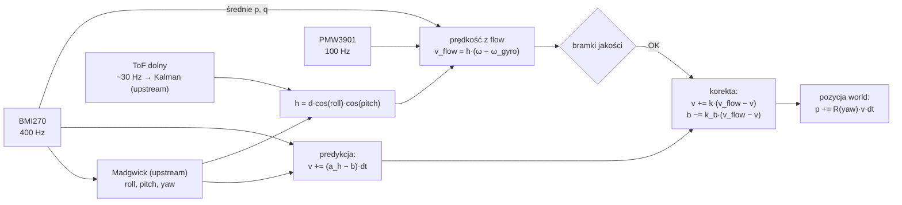

# 06. Position Hold — estymacja i sterowanie

Ten dokument opisuje, jak dron wie, gdzie jest (estymacja) i jak utrzymuje
pozycję (sterowanie). Część o sterowaniu zostanie dodana w gałęzi
`feat/position-controller`.

## Układy współrzędnych

| Układ | Osie | Uwagi |
|---|---|---|
| **body** (ciało drona) | x — do przodu, y — w prawo, z — w dół | konwencja upstreamu (`sensor.cpp`) |
| **heading** (kursowy) | jak body, ale bez przechylenia i pochylenia | płaszczyzna pozioma, obrócona razem z dronem wokół osi pionowej |
| **world** (świat) | heading obrócony o kąt yaw | początek = miejsce startu / ostatniej zmiany trybu |

Kąty: roll dodatni = prawa strona w dół, pitch dodatni = nos w górę,
yaw dodatni = obrót w prawo (patrząc z góry). Prędkości kątowe p, q, r — wokół osi x, y, z.

⚠️ Kąt yaw pochodzi z filtru Madgwicka bez magnetometru i **dryfuje** (rzędu stopni
na minutę). Wpływa to tylko na kierunek, w którym całkowana jest pozycja
w układzie world — w krótkich lotach jest to akceptowalne.

## Estymacja prędkości i pozycji



Kod: `drone/lib/poshold/src/position_estimator.*` (niezależny od sprzętu, testowany
`native`), sterownik czujnika `drone/src/pmw3901.*`, połączenie z pętlą upstreamu
`drone/src/poshold_glue.*`.

### 1. Wysokość nad podłożem

Dolny ToF mierzy odległość wzdłuż swojej osi (skośnie, gdy dron jest przechylony).
Upstream filtruje ją filtrem Kalmana (`Altitude2`). Wysokość prostopadła
(płaska podłoga):

```
h = d · cos(roll) · cos(pitch)
```

### 2. Prędkość z optical flow

PMW3901 zwraca przyrosty `Δx, Δy` (zliczenia) od poprzedniego odczytu. Po
przemapowaniu osi czujnika na osie drona (`kFlowSwapXY`, `kFlowSignX/Y`) prędkość
kątowa „przesuwania się podłogi”:

```
ωx = Δx_body · K / Δt        ωy = Δy_body · K / Δt        K = kFlowRadPerCount [rad/zliczenie]
```

Ruch obrazu ma dwie przyczyny: przesunięcie drona i jego obrót. Gdy dron pochyla
nos w górę (q > 0), oś czujnika „przesuwa się” po podłodze do przodu — tak samo
jak przy locie do przodu. Przy przechyle w prawo (p > 0) — w lewo. Stąd:

```
ωx = vx / h + q      →   vx = h · (ωx − q)
ωy = vy / h − p      →   vy = h · (ωy + p)
```

p i q są uśredniane ze wszystkich próbek żyroskopu (400 Hz) z okresu między
odczytami flow.

### 3. Fuzja z akcelerometrem (filtr komplementarny)

Siła właściwa z akcelerometru w układzie body `f` [g] jest obracana do układu
heading (usuwa to wpływ grawitacji):

```
a_x = g · ( cos(pitch)·fx + sin(pitch)·sin(roll)·fy + sin(pitch)·cos(roll)·fz )
a_y = g · ( cos(roll)·fy − sin(roll)·fz )
```

Predykcja co 2,5 ms: `v += (a − b)·dt`. Korekta przy każdej dobrej próbce flow
(co 10 ms), z błędem `e = v_flow − v`:

```
v += k·e,   k = Δt / (τ_v + Δt),          τ_v = kVelCorrectionTau
b −= k_b·e, k_b = Δt / (τ_b · τ_v),       τ_b = kAccelBiasTau
```

Akcelerometr wygładza zaszumioną i skwantowaną prędkość z flow; flow usuwa
dryf całkowania akcelerometru i estymuje jego bias. Uzasadnienie wyboru:
[ADR 0004](decyzje/0004-filtr-komplementarny.md).

### 4. Pozycja

```
p_world += R(yaw) · v · Δt
```

Pozycja jest całką prędkości — **dryfuje** (błąd skali flow, kwantyzacja, dryf yaw).
To akceptowane założenie tej wersji: utrzymanie pozycji ma działać przez
czas jednego lotu (~4 min), z dokładnością rzędu decymetrów.

### 5. Bramki jakości optical flow

Próbka jest odrzucana (`flow_reject` w telemetrii), gdy:

| Kod | Warunek | Parametr |
|---|---|---|
| 1 | brak odczytu czujnika lub brak pomiaru ToF | — |
| 2 | wysokość < 0,10 m | `kFlowMinHeight` |
| 3 | wysokość > 1,50 m | `kFlowMaxHeight` |
| 4 | SQUAL < 30 (słaba tekstura / oświetlenie) | `kFlowMinSqual` |
| 5 | \|p\| lub \|q\| > 3 rad/s | `kFlowMaxBodyRate` |
| 6 | \|roll\| lub \|pitch\| > 0,45 rad (~26°) | `kFlowMaxTilt` |

Histereza: flow jest „ważny” (`flow_valid`) po 5 kolejnych dobrych próbkach
(50 ms), „nieważny” po 3 kolejnych złych (30 ms). Bez korekt prędkość jest dalej
całkowana z akcelerometru, ale tryb Position Hold po utracie ważności flow
przełączy się na Stable + Auto Altitude (gałąź `feat/position-controller`).

### Rozdzielczość i ograniczenia

- Przy domyślnym `K ≈ 0,021 rad` jedno zliczenie na próbkę (10 ms) na wysokości
  0,5 m odpowiada ~1 m/s. Pojedyncze próbki są więc mocno skwantowane — dlatego
  korekta jest łagodna (τ_v = 0,15 s), a prędkość wynikowa ma szum rzędu
  ±0,05 m/s (sprawdzone w symulacji w testach `native`). ⚠️ Rzeczywista
  rozdzielczość czujnika (zliczenia na piksel) do weryfikacji kalibracją.
- Założenie płaskiej podłogi: progi, stopnie i ruchome obiekty pod dronem
  zaburzają pomiar.
- Orientacja montażu PMW3901 na StampFly nie jest udokumentowana — mapowanie osi
  trzeba wyznaczyć próbą z przenoszeniem drona (zob. niżej). Do tego czasu
  `kFlowAxesVerified = false` i Position Hold nie da się włączyć.

## Kalibracja optical flow

Szczegółowa procedura: [08-testy.md](08-testy.md#kalibracja-optical-flow-przenoszenie-w-ręku).
Skrypt `tools/flow_calibration.py` wylicza z logu `kFlowSwapXY`, `kFlowSignX`,
`kFlowSignY` i `kFlowRadPerCount`.

## Sterowanie

Zostanie opisane w gałęzi `feat/position-controller`.
